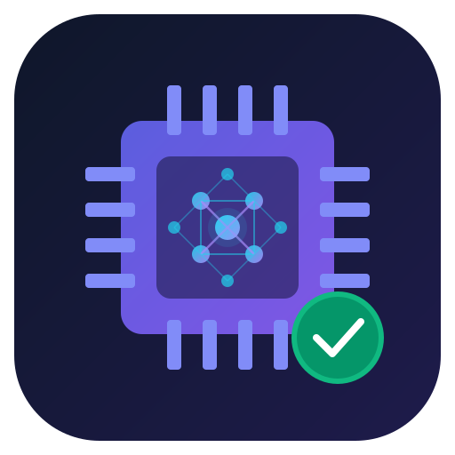
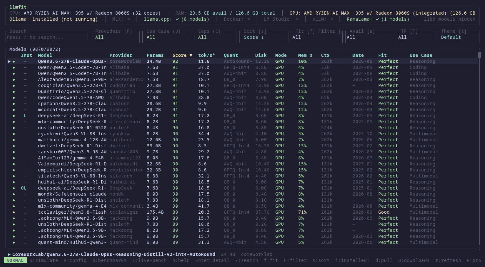

# llmfit

<p align="center">
  
</p>

<p align="center">
  <a href="README.md">English</a> ·
  <b>Deutsch</b> ·
  <a href="README.zh.md">中文</a> ·
  <a href="README.ja.md">日本語</a>
</p>

<p align="center">
  <a href="https://github.com/AlexsJones/llmfit/actions/workflows/ci.yml"></a>
  <a href="https://crates.io/crates/llmfit"></a>
  <a href="LICENSE"></a>
  <a href="https://about.signpath.io"></a>
</p>
<p align="center">
  <a href="https://trendshift.io/repositories/21325?utm_source=repository-badge&amp;utm_medium=badge&amp;utm_campaign=badge-repository-21325" target="_blank" rel="noopener noreferrer"></a>
</p>

Finde heraus, welche quelloffenen Large Language Models (LLMs) auf deiner Hardware gut laufen. `llmfit` prüft CPU, Arbeitsspeicher, GPUs, VRAM und Beschleunigerkonfiguration und empfiehlt Modelle mit verschiedenen gängigen Quantisierungen.

**📊 Neu: Benchmarks durchführen und teilen — echte Messwerte von deinem Rechner, bessere Schätzungen für alle.** Lade ein Modell herunter, starte es und miss die tatsächlichen Token pro Sekunde auf deiner Hardware. Anschließend kannst du die Ergebnisse direkt aus der TUI als Pull Request zum Projekt beitragen. Du brauchst weder die `gh`-CLI noch ein Konto bei einem Drittanbieter. Jeder Durchlauf wird zunächst lokal gespeichert. Deine eigenen Messwerte ersetzen die Schätzungen in der Kompatibilitätstabelle. Jeder zusammengeführte Beitrag wird mit der nächsten Version ausgeliefert: Wer identische Hardware nutzt, erhält mit `✓` gekennzeichnete Messwerte, bevor er selbst einen Benchmark durchführt. [Zur Schritt-für-Schritt-Anleitung für Benchmarks →](docs/benchmarking.md)



## Funktionen

- **Automatische Hardwareerkennung**: Erkennt CPU-Kerne, Arbeitsspeicher, verfügbare dedizierte und integrierte GPUs, VRAM sowie eine gemeinsame Speicherarchitektur (NVIDIA CUDA, Apple Silicon, AMD ROCm, Intel OneAPI).
- **Analyse der Modellkompatibilität**: Analysiert Parameterzahl, Kontextlänge und Quantisierungsformate (GGUF, AWQ, GPTQ, EXL2), um Speicherbedarf und Leistung in Token pro Sekunde abzuschätzen.
- **Interaktive TUI und Web-Dashboard**: Wähle zwischen einer schlanken Terminaloberfläche ohne zusätzliche Abhängigkeiten und einem umfangreichen Web-Dashboard.
- **REST-API**: Stellt HTTP-Endpunkte mit JSON-Ausgabe (`/api/v1/system`, `/api/v1/models`) für die Integration in Orchestrierungssysteme, Dashboards und automatisierte Bereitstellungspipelines bereit.
- **Plattformübergreifend**: macOS (Apple Silicon und Intel), Linux (x86_64 und ARM64) und Windows (x86_64).
- **Hunderte Modelle und Anbieter. Ein Befehl zeigt, was auf deiner Hardware läuft.**

Ein Terminalwerkzeug, das passende LLMs für RAM, CPU und GPU deines Systems findet. Es erkennt deine Hardware, bewertet jedes Modell nach Qualität, Geschwindigkeit, Kompatibilität und Kontext und zeigt dir, welche Modelle auf deinem Rechner gut laufen.

Enthält eine interaktive TUI (Standard) und einen klassischen CLI-Modus. Unterstützt mehrere GPUs, MoE-Architekturen, dynamische Quantisierungsauswahl, Geschwindigkeitsschätzungen und lokale Laufzeitumgebungen (Ollama, llama.cpp, MLX, Docker Model Runner, LM Studio).

---

## Verwandte Projekte

- [sympozium](https://github.com/sympozium-ai/sympozium/) — Agenten in Kubernetes verwalten.
- [llmserve](https://github.com/AlexsJones/llmserve) — eine einfache TUI zum Bereitstellen lokaler LLMs. Modell wählen, Backend wählen, starten.
- [llama-panel](https://github.com/AlexsJones/llama-panel) — eine native macOS-App zum Verwalten lokaler llama-server-Instanzen.
- [llmfit-gui](https://github.com/raiyyan729-cloud/llmfit-gui) — eine Windows-Desktopoberfläche (PowerShell + WinForms) für llmfit: Empfehlungen durchsuchen, Modelle für LM Studio/Ollama herunterladen und Benchmarks durchführen, alles per Mausklick.

---

## Dokumentation

Die verlinkten ausführlichen Anleitungen sind auf Englisch.

|  |  |
|---|---|
| **Erste Schritte** | [Installation](#installation) · [Verwendung](#verwendung) · [Funktionsweise](#funktionsweise) |
| **Anleitungen** | [TUI-Anleitung](docs/tui.md) · [Benchmarks Schritt für Schritt](docs/benchmarking.md) · [CLI und Automatisierung](docs/cli.md) · [Laufzeitumgebungen](docs/providers.md) · [OpenClaw-Integration](docs/openclaw.md) |
| **Referenz** | [Funktionsweise im Detail](docs/how-it-works.md) · [Plattform- und GPU-Unterstützung](docs/platform-support.md) · [Eigene Modelle](docs/custom-models.md) · [Entwicklung](docs/development.md) |
| **Projekt** | [Mitwirken](#mitwirken) · [Alternativen](#alternativen) · [Codesignierung](#codesignierung) · [Lizenz](#lizenz) |

---

## Installation

### Windows
```sh
scoop install llmfit
```

Falls Scoop noch nicht installiert ist, folge der [Scoop-Installationsanleitung](https://scoop.sh/).

### macOS / Linux

#### Homebrew

Vorkompilierte Binärdatei (empfohlen, funktioniert auf allen macOS-/Linux-Versionen):
```sh
brew install AlexsJones/llmfit/llmfit
```

Alternativ über die homebrew-core-Formel, die auf macOS-Versionen ohne vorgefertigtes Paket aus dem Quellcode baut:
```sh
brew install llmfit
```

#### MacPorts
```sh
port install llmfit
```

#### Schnellinstallation
```sh
curl -fsSL https://llmfit.axjns.dev/install.sh | sh
```

Lädt die Binärdatei der neuesten Version von GitHub herunter und installiert sie nach `/usr/local/bin` (oder nach `~/.local/bin`, wenn sudo nicht verfügbar ist).

**Ohne sudo nach `~/.local/bin` installieren:**
```sh
curl -fsSL https://llmfit.axjns.dev/install.sh | sh -s -- --local
```

### uv / pip
llmfit installieren oder aktualisieren:
```sh
uv tool install -U llmfit
```

Ohne Installation ausführen:
```sh
uvx llmfit
```

Du kannst llmfit auch wie gewohnt mit pip oder uv als Python-Paket installieren.

### Vorkompilierte Binärdateien

Lade Binärdateien für Linux, macOS und Windows direkt von der Seite [GitHub Releases](https://github.com/AlexsJones/llmfit/releases) herunter. Windows-Binärdateien sind nur signiert, wenn der vollständige `sign-windows`-Job der jeweiligen Version erfolgreich ist, einschließlich Signierung, erneuter Paketierung, Austausch der Artefakte und Hochladen der Prüfsummen. Eine Veröffentlichung kann dennoch ein unsigniertes Windows-Artefakt enthalten, wenn die Signierung übersprungen wird oder fehlschlägt. Prüfe die Signatur der ausführbaren Datei, wenn du eine signierte Binärdatei benötigst.

---

## Bereitstellung mit Containern

`llmfit` stellt ein Docker-Image für mehrere Architekturen (`ghcr.io/alexsjones/llmfit`) bereit. Es unterstützt sowohl die interaktive CLI/TUI als auch den Betrieb als Weboberfläche und API-Server ohne Terminalinteraktion.

### Interaktive TUI

Übergib die globale Option `--tui`, um die interaktive TUI zu starten:

```sh
docker run -it --rm ghcr.io/alexsjones/llmfit --tui
```

### Ohne Terminalinteraktion

Dieser Befehl gibt die JSON-Ergebnisse von `llmfit recommend` aus.

```sh
docker run ghcr.io/alexsjones/llmfit
```

Die JSON-Ausgabe von `llmfit recommend` lässt sich mit `jq` weiter abfragen:
```
podman run ghcr.io/alexsjones/llmfit recommend --use-case coding | jq '.models[].name'
```
Um stattdessen die interaktive TUI zu starten, übergib die globale Option `--tui`:
```sh
docker run --rm -it ghcr.io/alexsjones/llmfit --tui
```

### Aus dem Quellcode
```sh
git clone https://github.com/AlexsJones/llmfit.git
cd llmfit
cargo build --release
# Die Binärdatei liegt unter target/release/llmfit
```

---

## Verwendung

### Terminaloberfläche (TUI)

Starte `llmfit` ohne Optionen im Terminal, um die interaktive Modellübersicht zu öffnen:

```sh
llmfit          # Interaktive TUI: deine Hardware, alle Modelle, nach Bewertung sortiert
```

Die TUI zeigt oben die erkannte Hardware und bewertet jedes Modell nach Kompatibilität, Geschwindigkeit, Qualität und Kontext. Die [TUI-Anleitung](docs/tui.md) beschreibt Navigation, Planung, Simulation, Downloads, die Community-Rangliste und Benchmarks.

Tastenkürzel in der TUI:

- `b`: Community-Benchmarks öffnen; `I`: Live-Inferenz-Benchmarks öffnen
- `h`: Hilfe und Tastenkürzel anzeigen
- `↑` / `↓` oder `k` / `j`: Durch die Liste navigieren
- `/`: Modelle nach Name, Familie oder Quantisierung filtern
- `Esc`: Suche löschen / Zurück

### Befehlszeilenoptionen

```sh
# Hardwareinformationen und empfohlene Modelle auf der Standardausgabe ausgeben
llmfit recommend

# Systemprofil und Empfehlungen im JSON-Format ausgeben
llmfit recommend --json

# SSD-Kapazität für drei ausführbare Modelle schätzen
llmfit storage --keep 3 --selection largest --json

# Den integrierten HTTP-API-Server starten
llmfit serve --host 0.0.0.0 --port 8787
```

Unter [Speicherbedarf der Modellbibliothek](docs/cli.md#model-library-storage) findest du Details zur Modellauswahl, zur Reserve für das Betriebssystem, zum temporären Downloadspeicher, zum freien Speicherplatz und zur Hardware-Simulation.

### Weboberfläche und API-Server

```sh
docker run -d -p 8787:8787 ghcr.io/alexsjones/llmfit serve
```

#### Docker Compose

```yaml
---
services:
  llmfit:
    image: ghcr.io/alexsjones/llmfit:latest
    container_name: llmfit
    restart: unless-stopped
    command: ["serve", "--host", "0.0.0.0", "--port", "8787"]
    ports:
      - "8787:8787"
    healthcheck:
      test: ["CMD", "curl", "-f", "http://localhost:8787/health"]
      interval: 15s
      timeout: 5s
      retries: 3
      start_period: 10s
```

Für Skripte, Agenten und klassische Terminalausgabe:

```sh
llmfit fit                    # Tabelle aller Modelle nach Kompatibilität sortiert
llmfit recommend --json       # Beste Empfehlungen als JSON für Agenten und Skripte
llmfit info "<model>"         # Ein Modell: Kompatibilität, Schätzgrundlage, Prüfbefehle
llmfit bench                  # Tatsächliche Token/s und TTFT beim laufenden Anbieter messen
llmfit doctor                 # Hardware-Erkennungsbericht für Fehlerberichte
llmfit serve                  # API und Weboberfläche starten
```

Vollständige Referenz: [CLI und Automatisierung](docs/cli.md).

Im Web-Dashboard und in der Desktop-App kannst du im Sprachmenü **Deutsch** auswählen. Eine deutsche Browsersprache wird automatisch erkannt; eine manuelle Auswahl wird gespeichert.

---

## Community und Benchmarks

`llmfit` enthält Hardwareerkennung und Leistungsbenchmarks, die von der Community beigetragen wurden. Du kannst deine Hardware-Benchmark-Ergebnisse mit folgendem Befehl teilen:

```sh
llmfit bench --share
```

---

## Funktionsweise

llmfit erkennt deine Hardware (RAM, CPU, GPU/VRAM, Backend) und bewertet anschließend jedes Modell im Katalog nach vier Kriterien: Speicherkompatibilität, geschätzte Geschwindigkeit, Qualität und Kontext. Die Geschwindigkeitsschätzungen basieren auf einem Speicherbandbreitenmodell, das durch Messungen der Laufzeitumgebungen und tatsächliche Community-Messwerte gestützt wird. Jede Schätzung enthält ihre Eingangswerte. So zeigt `llmfit info` genau, welche Annahmen hinter einem Wert stehen und wie du ihn auf deinem Rechner überprüfen kannst.

Alle Details, einschließlich Schätzformeln und Modelldatenbank: [So funktioniert llmfit](docs/how-it-works.md).

---

## Mitwirken

Beiträge sind willkommen, insbesondere neue Modelle.

### Vor dem Einreichen eines Pull Requests

Führe bitte `cargo fmt` aus, bevor du deine Änderungen hochlädst. Die meisten fehlgeschlagenen CI-Prüfungen entstehen durch unformatierten Code:

```sh
cargo fmt
```

Anleitungen zum Hinzufügen von Modellen — lokal (ohne erneuten Build) oder zum integrierten Katalog: [Eigene Modelle](docs/custom-models.md).

---

## Alternativen

Wenn du einen anderen Ansatz suchst, schau dir [llm-checker](https://github.com/Pavelevich/llm-checker) an: ein Node.js-CLI-Werkzeug mit Ollama-Integration, das Modelle direkt herunterladen und benchmarken kann. Es führt Modelle über Ollama tatsächlich auf deiner Hardware aus, statt ihre Leistung anhand der technischen Daten zu schätzen. Das ist nützlich, wenn du Ollama bereits installiert hast und die tatsächliche Leistung testen möchtest. MoE-Architekturen (Mixture-of-Experts) werden nicht unterstützt: Alle Modelle werden als dichte Modelle behandelt. Die Speicherschätzungen für Modelle wie Mixtral oder DeepSeek-V3 beziehen sich daher auf die gesamte Parameterzahl statt auf die kleinere aktive Teilmenge.

---

## Codesignierung

Die Windows-Binärdateien von llmfit sollen über [SignPath.io](https://about.signpath.io/) digital signiert werden (Authenticode). Das kostenlose Codesignierungszertifikat stellt die [SignPath Foundation](https://signpath.org/) bereit. Eine Version ist nur signiert, wenn der vollständige `sign-windows`-Job erfolgreich ist, einschließlich Signierung, erneuter Paketierung, Austausch der Artefakte und Hochladen der Prüfsummen. Die Signierung kann übersprungen werden oder fehlschlagen, während die Version trotzdem ein unsigniertes Artefakt veröffentlicht. Prüfe die Signatur der ausführbaren Datei, bevor du dich darauf verlässt.

Die Signierung erfolgt automatisch in der [Release-Pipeline](.github/workflows/release.yml): Nur Artefakte, die GitHub Actions aus diesem Repository erstellt hat, werden zur Signierung eingereicht. Signierungsanfragen werden vom Projektbetreuer ([@AlexsJones](https://github.com/AlexsJones)) genehmigt.

**Richtlinie zur Codesignierung:** Siehe die [Richtlinie und Bedingungen der SignPath Foundation](https://signpath.org/terms).

**Datenschutz:** Dieses Programm überträgt keine Informationen an andere vernetzte Systeme, sofern dies nicht ausdrücklich vom Nutzer oder der Person verlangt wird, die es installiert oder betreibt. llmfit kontaktiert externe Dienste nur, wenn du die entsprechende Funktion ausdrücklich nutzt (z. B. Modelldownloads, Abfragen von Laufzeitumgebungen oder die Community-Rangliste).

---

## Lizenz

MIT
