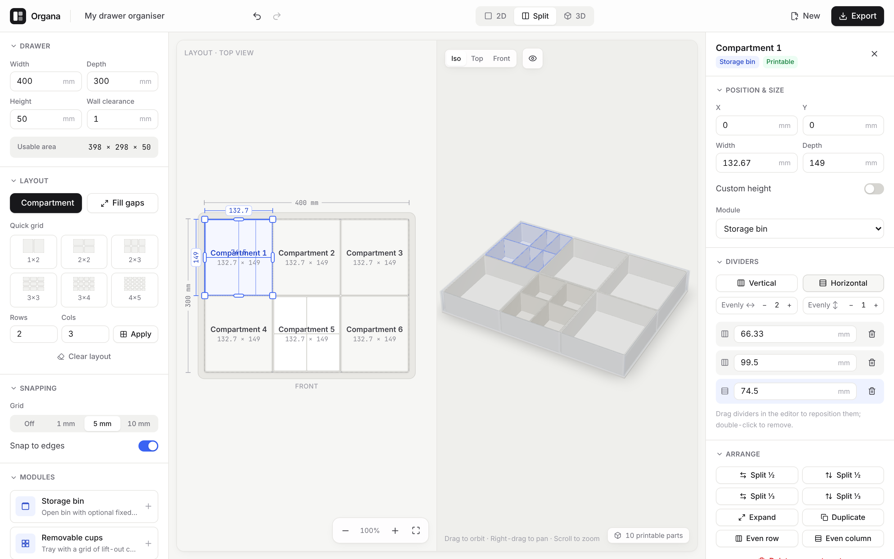

# Organa: drawer organiser designer

Organa is a browser app for designing custom, 3D-printable drawer organisers. You enter your drawer's inside dimensions, lay out compartments in a top-down editor and check the result in a live 3D preview. It then exports watertight STL files that are ready to slice.



```sh
npm install
npm run dev        # http://localhost:5173
npm test           # geometry, layout and store tests
npm run build      # type-check and build a static site into dist/
```

There is no backend. Everything, CSG included, runs in the browser, and designs are saved to `localStorage`.

## Features (MVP)

- **Drawer setup**: width, depth, height, wall clearance and floor thickness. The usable area is calculated for you.
- **2D layout editor**:
  - Move compartments by dragging. They slide along neighbours and never overlap.
  - Resize from edges or corners.
  - Snap to the grid (1, 5 or 10 mm) and to neighbouring edges, with guide lines.
  - Live dimensions and gap measurements.
  - Double-click empty space to fill it with a new compartment.
  - Zoom and pan.
- **Layout tools**:
  - Quick grids
  - Split into ½ or ⅓
  - Expand to fill
  - Fill all gaps
  - Even out a row or column
  - Duplicate
  - Numeric X, Y, W, D input
  - Per-compartment height
  - Undo/redo
- **Dividers**: add vertical or horizontal dividers, space them evenly, drag to reposition, or type exact positions.
- **3D preview**: orbit, pan and zoom, with Iso, Top and Front presets. Click to select a compartment; the selection is highlighted in both views. The drawer is shown as a transparent ghost. The preview renders the exact meshes that get exported.
- **Customisation**:
  - Wall, floor and divider thickness
  - Divider height
  - Rounded or square corners and corner radius
  - Bin height
  - Fit gap between bins

  The defaults suit a 0.4 mm nozzle: 1.6 mm walls, 1.2 mm floor.
- **Export**:
  - One STL per part, or all parts as a ZIP with a parts list
  - An assembled STL with every part in position
  - Per-part dimensions, estimated PLA weight and watertightness check
  - Build-volume warnings (default 256³, configurable, allows 90° rotation) with one-click *Split to fit*
- **Modules**: *Storage bin* and *Removable cups* (a tray plus a grid of lift-out cups, exported as separate parts). Planned modules appear in the library as "Soon".

Keyboard: `A` add · `Del` delete · `⌘/Ctrl+D` duplicate · arrows nudge (Shift ×10) · `⌘Z` / `⇧⌘Z` undo/redo · `1` `2` `3` switch views · `Esc` deselect.

## Architecture

```
src/
  model/      Serialisable design data (mm) + defaults. No rendering state.
  layout/     Pure 2D operations: collisions, snapping, split, grid, fill, validation.
  store/      zustand stores: design + undo/redo history (persisted), UI state.
  geometry/   CSG kernel loader, bin builder, design→parts pipeline, STL/ZIP writer, mesh checks.
  modules/    Module registry: the extension point for compartment types & accessories.
  components/ React UI: 2D editor (SVG), 3D viewport (react-three-fiber), panels, dialogs.
```

**Data flow:** `Design` (store) → `layout/*` keeps it valid → `geometry/parts.ts` turns each compartment into `PartMesh`es → the 3D view and the STL exporter both consume those meshes. The 2D editor only edits data; it never touches geometry.

### Printable geometry

The geometry comes from [manifold-3d](https://github.com/elalish/manifold), an exact CSG kernel compiled to WASM. Every result it returns is a closed, oriented 2-manifold. A bin is built like this:

```
solid  = extrude(roundedRect(w, d, r), h)
pocket = extrude(roundedRect(w − 2t, d − 2t, r − t), h) raised by the floor thickness
bin    = (solid − pocket) ∪ ⋃(divider slab ∩ solid)
```

- The output is deterministic: there are fixed circle segment counts and no randomness. Meshes are cached by a key built from every shape-affecting input, so moving a compartment never re-runs CSG.
- Local frame: X is width, Y points towards the back of the drawer, Z is up. Each part's mesh starts at the origin, and its placement in the drawer is stored separately.
- The tests check that each part is watertight by an independent directed-edge check on the exported mesh, has positive volume and the expected dimensions, and that the generated STL is byte-for-byte identical across rebuilds.

### Extending with accessories

A new compartment type is a `ModuleDefinition` in `src/modules/registry.ts`:

```ts
{
  kind: 'pen-holder', label: 'Pen holder', status: 'available',
  params: [{ key: 'slots', label: 'Slots', type: 'number', min: 1, max: 10 }],
  defaults: { slots: 4 }, supportsDividers: false,
  build: ({ kernel, bin, params }) => [/* BuiltPart[]: { key, name, role, manifold, offset } */],
}
```

The library, properties panel (generated from `params`), 2D editor, 3D preview and export pick up a new module automatically. A future shared mounting system plugs in through the `MountingSystem` interface in `src/modules/types.ts` (`applyToBin`), which the parts pipeline already calls. Only `none` exists today.

## Next steps

- More modules: screw organisers with scooped floors, pen and tool holders, cable storage, stackable bins with a lip.
- A shared mounting interface (floor sockets or rails) for removable accessories.
- Finger scoops, label tabs and a stacking lip as per-bin options.
- Cutting oversized parts with alignment features instead of splitting the layout.
- 3MF export with per-part plates.
